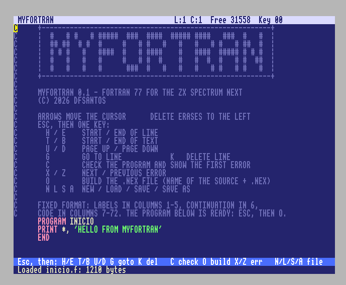
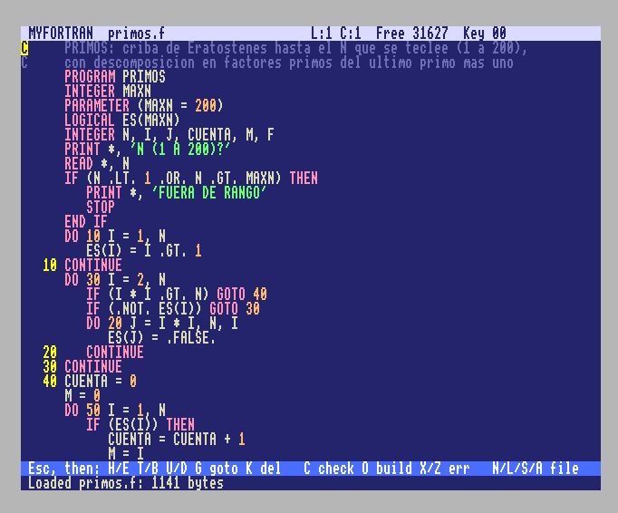

# MyFortran

A **Fortran 77** compiler for the **ZX Spectrum Next**, with its own editor (Turbo Pascal 3.0 style). Everything runs on the
Next: you type the program, compile it, and get a stand-alone `.nex` file. This is a **didactic** project: the code is
written to be understood, every decision has its own document, and nothing is considered proven unless it has been measured.

Version **0.1** (first public release). MIT license (see `LICENSE`).

> The documentation under `docs/` (chapters, design decisions, TAC specification) is written in Spanish.

| Start screen and help | Editing `primos.f` (sieve of Eratosthenes) |
|---|---|
|  |  |

## What is in 0.1

A single `MyFortran.nex` (editor + compiler, split across eight 16 KB banks) that generates Z80 `.nex` programs.

**Types:** `INTEGER` (16 bits), `REAL` (32-bit IEEE, in software), `LOGICAL`, `CHARACTER*n` with substrings `S(i:j)`.
`DOUBLE PRECISION` is recognized but **not** supported.

**Statements:** `PROGRAM`, `END`, type declarations, `DIMENSION`, `PARAMETER`, `DATA`, `EXTERNAL`, `INTRINSIC`, assignment,
logical `IF`, block `IF` (`ELSE IF`, `ELSE`) and arithmetic `IF`, `DO` (with step, REAL loop variable and shared terminal label),
simple and computed `GO TO`, `CONTINUE`, `STOP`, `PRINT *`, `READ *` (from the keyboard), `SUBROUTINE`, `FUNCTION`, `CALL`,
`RETURN` and statement functions. Vectors and matrices (up to 2 dimensions, lower bounds other than 1), also as arguments
with adjustable dimensions.

**Intrinsic functions:** `ABS`, `MOD`, `SIGN`, `DIM`, `MAX`, `MIN` (and their variants `IABS`, `ISIGN`, `IDIM`, `MAX0`, `AMAX1`...),
`AINT`, `ANINT`, `NINT`, `SQRT`, `LEN`, `INT`, `REAL`, `FLOAT`, `IFIX`.

### Known limitations of 0.1

The compiler rejects the following with a clear message (usually `not supported yet`); they are planned for 0.2 and 0.3:

- `DOUBLE PRECISION`; `COMMON`, `EQUIVALENCE`, `SAVE`, `BLOCK DATA`, `ENTRY`, alternate `RETURN`.
- Procedures and intrinsics passed as arguments to other procedures.
- Input/output: only `PRINT *` and `READ *` (list-directed; no `FORMAT`, no `WRITE`, no files). `READ` does not accept whole
  arrays, substrings, implied `DO` or `r*c` repeat counts. `DATA` has no implied `DO` or substrings. A whole array cannot be printed.
- Arrays with more than 2 dimensions.
- Intrinsics `ICHAR`, `CHAR`, `INDEX`, `LGE/LGT/LLE/LLT` and the mathematical functions `EXP`, `LOG`, `SIN`, `COS`, `TAN`, `ATAN`...
  (`SQRT` is supported). Power with a `REAL` exponent (`2.0**0.5`); with an integer exponent it works.
- 16-bit `INTEGER`: overflow wraps around silently; an out-of-range constant is a compile-time error.
- `REAL` input is exact only up to about 7 significant digits.
- Limits imposed by the Next's stack (see "Memory"): up to 10 nested parentheses, 5 levels of `F(F(...))` and 16 nested
  `IF`/`DO` blocks. A statement may have 20 lines (1 initial + 19 continuation) and about 64 expression nodes.

## Using MyFortran on the Next

Copy `MyFortran.nex` to the SD card (or to the emulator's folder) and run it. Program names must be **8.3 with no underscore**
(`fibo.f`, `n1orden.f`) so that they can be launched from the Browser.

The editor has two modes. You type directly; to give a command, press **Esc** (CAPS SHIFT + SPACE) and then a letter:

| Key after Esc | Command |
|---|---|
| `H` / `E` | start / end of line |
| `T` / `B` | start / end of text |
| `U` / `D` | page up / page down |
| `G` | go to line |
| `K` | delete line |
| `C` | **check** (compiles without generating anything; shows the errors) |
| `O` | **build**: generates the program's `.nex` (named after the source file) |
| `X` / `Z` | next / previous error |
| `N` `L` `S` `A` | new, load, save, save as |
| `5` `6` `7` `8` | cursor left, down, up, right |

Example programs: `examples/leer.f` (reads data from the keyboard), `examples/fibo.f`, `examples/primos.f`...
`READ` waits for a line and ends with ENTER; `PRINT` writes to the screen and scrolls it automatically when it reaches the bottom.

## Building MyFortran from source

Windows with VS Code (`Ctrl+Shift+P` -> `Tasks: Run Task`). Requirements: `gcc` from MSYS2 UCRT64 (`C:\msys64\ucrt64\bin`) for the PC
tests and [z88dk](https://z88dk.org) in `C:\z88dk` for the Next. `tools/build.ps1` adjusts the `PATH` only while building.

| Task | What it does |
|---|---|
| PC: tests (compile and run) | Builds the core with gcc and runs all the suites (`compiler/tests/test_*.c`) |
| Next: MyFortran.nex (compile editor + compiler) | Generates `build/next/MyFortran.nex` and reports the free space in each bank |
| PC: TAC / Z80 of the open file | Compiles the open `.f`, shows its intermediate code or its assembly, and runs it in an emulator |
| Editor PC: tests, Editor Next: ... | The same for the stand-alone editor (`tools/build_editor.ps1`) |
| PC/Next: smoke | Check that the tools work |

You can clean up with `tools\limpiar.bat` (removes `build\`, temporary files and leftovers; asks for confirmation).

## How it is built

A portable C core (no `malloc`, fixed-size tables, no `float`) with these phases: statement reader and lexer ->
expression and statement parser (AST in a data page) -> semantic analysis (symbol table, types, blocks) -> three-address
code (TAC) -> Z80 generator with a small runtime library (REAL, PRINT, READ) -> `.nex`. The same code runs on the PC (with a
TAC interpreter and a Z80 emulator for testing) and on the Next.

On the Next, memory is the problem: 48 KB visible. The code lives in 16 KB banks with resident **trampolines**, and the tables
live in 8 KB data pages (`banco.h`).

### Memory (0.1 measurements, Next)

Free bytes at the end of each bank, after building `MyFortran.nex`: 41 (editor) 4,584 B, 42 2,451 B, 43 2,215 B, 44 2,133 B,
45 1,906 B, 46 748 B, 47 959 B, 48 3,087 B. The end of the resident `bss` is at `$BCE8` and the stack reaches `$BFAD`. The stack
used while compiling and building the worst-case program (`examples/` and `tools/medir/pila/maximo.f`) is **583 of 645 bytes**
(measured with `Esc` `M`, a hidden development command).

## Tests

`PC: tests` runs about 36,000 tests split by chapter (lexer, parser, semantic analysis, TAC, Z80 generator, subprograms,
DATA/READ), more than 465,000 REAL-arithmetic tests against an oracle, random-program fuzzers, and `test_programas.c`:
**312 complete programs** (`compiler/tests/programas/`, `examples/` and `compiler/tests/ejemplos/`) that are run as TAC and as
Z80 and compared with the expected output, computed independently in Python (`oraculo.py`). On the Next there are six check
programs in `examples/next/` (with their own `LEEME.md`).

## Layout

| Folder | Contents |
|---|---|
| `compiler/src`, `compiler/include` | The compiler in portable C; `mf_api.h` is the contract with the editor |
| `compiler/tests` | Per-chapter tests and complete programs |
| `editor/` | The editor (gap buffer, 80-column screen, esxdos) and its tests |
| `platform/pc`, `platform/next` | Machine-dependent code: data pages, files, test emulator |
| `tools/` | Build scripts (`build.ps1`), Z80 routine generator (`rtgen/`), fuzzers, measurements and the Next bank glue (`spike/e1_*`) |
| `examples/` | Example programs (and the Next tests in `examples/next/`) |
| `docs/` | `capitulos/` (chapters 1-6, one per phase: theory, decisions and tests), `decisiones/` (why each thing was decided), `editor/` and `especificacion-tac.md` |

Design decisions are numbered in `docs/decisiones/` (0001 stages ... 0015 data and input).

## Roadmap

- **0.1** (this one): everything above.
- **0.2**: `COMMON`, `SAVE`, procedures and intrinsics as arguments.
- **0.3**: alternate `RETURN`, `ENTRY`, `EQUIVALENCE`, `BLOCK DATA`.

## Environment issues (Windows)

- **gcc dies silently (exit code 1, no message).** `C:\z88dk\bin` ships its own DLLs
  (`libgcc_s_seh-1.dll`, `libstdc++-6.dll`, `libwinpthread-1.dll`, `zlib1.dll`...) with the same names as the MSYS2 ones,
  and `cc1.exe` loads the wrong ones if z88dk comes first in the `PATH`.
  Fix: `tools/build.ps1` prepends to the `PATH` the directory of the compiler in use
  (MSYS2 `C:\msys64\ucrt64\bin` for PC, z88dk for the Next), only while building.
  Consequence: always build through the tasks, not with `gcc` by hand in the terminal. (Probable cause, supported by the fact
  that building with a clean PATH worked.)
